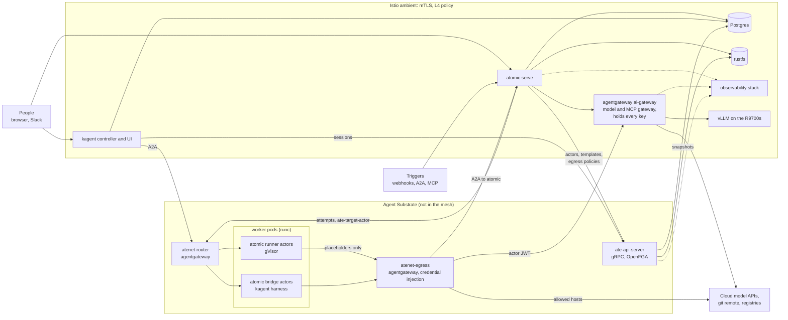

# atomic on Agent Substrate: k3s with kagent, Istio ambient and agentgateway

A design for running atomic's agents on one workstation's Kubernetes, with
every untrusted execution in an Agent Substrate actor. `atomic serve` runs as
an ordinary Deployment on Postgres; atoms that run code or need a shell run in
Substrate actors under gVisor (or Cloud Hypervisor microVMs); kagent 1.0 gives
people conversations and a UI and can start atomic workflows; agentgateway
holds every model and tool credential; Istio ambient puts mTLS and L4 policy
between the trusted services. Everything runs on single-node k3s on this
repository's development host.

> **Status.** Design only, and forward-looking; nothing here deploys yet. It
> assumes atomic 1.0 as planned in `atomic-planning/atomic-scaffold-plan.md`,
> in particular `atomic serve` on Postgres (M18), A2A (M22), containers (M24)
> and atomic's own telemetry export (M44), the same assumptions as
> [`../aws-lambda`](../aws-lambda) minus its AWS-specific ones. Upstream facts
> were read on 2026-11-17 from clones of
> [agent-substrate/substrate](https://github.com/agent-substrate/substrate)
> (`3d574499`), [kagent-dev/kagent](https://github.com/kagent-dev/kagent)
> (`29aaacd`), [agentgateway/agentgateway](https://github.com/agentgateway/agentgateway)
> and its website, and from the projects' docs; see [Sources](#sources).
>
> Its main output is [the gaps in atomic](#gaps-in-atomic), and
> [what the 1.0 releases change in atomic's plan](#what-the-10-releases-change-in-atomics-plan).

## What it runs

The same agents as the AWS design: triggers start durable workflows whose
steps are mostly lite atoms, executor calls and Codex atoms, gates wait for
people, effects go through the effect ledger, and code runs only where an
atom carries it (see [What it runs](../aws-lambda/README.md#what-it-runs)
there). Two things differ here:

- **The sandbox is a Substrate actor,** not a Lambda invocation: a stateful
  OCI image, multiplexed with others onto warm worker pods, suspended to a
  snapshot when idle and resumed on demand, reachable only over HTTP(S)
  through Substrate's router, and with no credentials inside.
- **People can also work through kagent,** whose conversations can start an
  atomic workflow and answer its gates, alongside atomic's own channels.

## The platform

| Part | Version | Notes |
| --- | --- | --- |
| k3s | v1.37.x (installed: v1.36.5+k3s1) | Single node, bare metal. 1.37 has the pod-certificate APIs Substrate needs without feature gates (kagent's install docs require Kubernetes 1.37+; Solo's OSS guide uses 1.35 with the gates on). Embedded containerd, flannel and the embedded NetworkPolicy controller |
| Agent Substrate | v1.0.0 (2026-11-05), from the `kagent-dev/substrate` fork's Helm charts | kagent 1.0 requires it and pins the fork (`go.ate.dev/substrate v1.0.0 => github.com/kagent-dev/substrate v1.0.0`). Upstream ships only a Go installer (`ate-setup`) for kind and GKE |
| kagent | v1.0.1 (2026-11-12) | Charts `oci://ghcr.io/kagent-dev/kagent/helm/{kagent-crds,kagent}`. Every agent is a Substrate actor; there is no Deployment-based runtime any more |
| agentgateway | v1.7.0 (2026-10-27), its own controller | Charts `oci://cr.agentgateway.dev/charts/{agentgateway-crds,agentgateway}`. Supports Kubernetes 1.32–1.37, Gateway API 1.4–1.6 and Istio 1.23–1.31 |
| Istio | 1.32.0 (2026-11-09), ambient profile | Supports Kubernetes 1.33–1.37. agentgateway 1.7's compatibility table stops at Istio 1.31, so its mesh integration on 1.32 is checked in spike 2; 1.31.4 is the fallback (it fixes ISTIO-SECURITY-2026-009, which lists 1.30 and 1.31 releases as affected) |
| Gateway API | v1.6.x CRDs | Shared by agentgateway and Istio |
| gVisor | 20261102.0, inside Substrate's worker pods | Fetched by Substrate's `gvisor-default` SandboxConfig, systrap platform, netstack networking. No host install (decision 3) |
| Cloud Hypervisor | Kata 4.3.1 stack, inside Substrate's microVM worker pods | Optional second worker pool; this host is bare metal with `/dev/kvm`, so it qualifies |
| PostgreSQL | 18.x | One instance; separate databases and roles for Substrate, kagent and atomic |
| Object storage | rustfs (Substrate's local default), S3 API | Substrate snapshots and atomic's artifact store, in separate buckets |

## What the 1.0 releases change in atomic's plan

The plan's [Execution backends and Agent Substrate](../../atomic-planning/atomic-scaffold-plan.md)
section was written from a clone of Substrate dated 2026-11-14 and from the
kagent 1.0 announcement. The releases and their docs settle several of its
open points, and change some:

1. **kagent's harness contract is now known, and atomic cannot be a harness.**
   A kagent harness is an image that runs *inside* a Substrate actor: it
   serves private A2A over gRPC (`lf.a2a.v1.A2AService`) on port 80 and
   `GET /readyz` on 8081, fetches its configuration from kagent's
   `BootstrapService`, must persist A2A tasks through kagent's
   `TaskStoreService` ("an upstream A2A server with only an in-memory store is
   insufficient"), runs at most one execution per actor, and is suspended
   between turns. A long-lived `atomic serve` holding leases, timers and
   webhooks is none of that. M26 becomes a thin **bridge harness** that runs
   in a kagent actor and forwards to `atomic serve`'s A2A server (gap 13).
2. **Actor templates and egress policies are API records, not Kubernetes
   objects.** Substrate's only CRDs are `WorkerPool`, `SandboxConfig` and
   `CSIDriverConfig` (`ate.dev/v1`). ActorTemplates, Actors, EgressPolicies,
   atespaces and access policies live in Substrate's Postgres behind the
   `substrate.ateapi.v1.Control` gRPC service, so atomic must create them
   through the API; Helm or GitOps cannot declare them (gap 2).
3. **"Execution only in the actor" survives the transport question.** At
   atomic's pinned Codex (`rust-v0.169.0`), exec-server's remote transport is
   JSON-RPC over WebSocket, with stdio and an outbound Noise relay as the
   alternatives. Substrate's docs say the router carries "only HTTP(S)
   traffic over the tunnel", and its egress gateway blocks WebSocket, so the
   relay cannot leave an actor. But an inbound WebSocket reaches an actor
   through both router paths, resumes a suspended one, and outlives the
   router's 60 s request timeout ([spike 4](spikes/results.md#4-websocket-through-the-router)).
   Codex's own exec-server through it is the remaining check (decision 7,
   gap 5).
4. **No SPIRE.** SPIFFE identities come from Kubernetes pod certificates
   (`PodCertificateRequest`, issued by Substrate's `podcertcontroller`).
   Actor X.509 identities are
   `spiffe://substrate-actor.local/worker-for-actor/<atespace>/<name>`, with
   the trust domain hard-coded, and actor JWTs carry `sub:
   actor/<atespace>/<name>`. Actors never hold either: the worker's tunnel and
   the egress gateway do.
5. **Snapshots in kagent are volumes only.** kagent always snapshots at
   `VOLUMES` fidelity and suspends synchronously; Substrate's default is
   `MEMORY` and asynchronous. Memory snapshots are pinned to the template and
   the sandbox runtime version, so a gVisor upgrade invalidates them. The
   plan's rule that durare is the truth and snapshots a cache stands, and
   atomic should treat memory snapshots as an optimisation only.
6. **kagent's MCP server cannot host runners.** Its sandbox tools
   (`create_sandbox`, `start_sandbox_process`, `read_sandbox_file`, …) exist,
   but their sandboxes have "no network egress … currently", so an atom that
   needs a git remote or a package registry cannot use them. The `substrate`
   backend calls Substrate's API directly.
7. **Atespaces are global groupings, not namespaces.** The plan's mapping of
   one namespace per tenant onto atespaces holds only as a convention atomic
   keeps: an atespace has its own access policies in Substrate's embedded
   OpenFGA, and the Kubernetes secrets the egress gateway may read are granted
   per atespace and namespace separately.
8. **agentgateway is already inside Substrate.** Substrate's ingress router
   and egress gateway run on Envoy or agentgateway (`substrateIngress`,
   `substrateEgress` and credential-provider support in agentgateway), and
   kagent's charts choose agentgateway. The plan's "egress gateway injects the
   key" is agentgateway in this deployment.

## Where each part runs

| Namespace | What | Runtime | Ambient |
| --- | --- | --- | --- |
| `istio-system` | istiod, istio-cni, ztunnel | runc | (the mesh) |
| `atomic` | `atomic serve`; later the console | runc | Yes |
| `kagent` | kagent controller (`:8083`: gRPC, A2A, MCP), UI, oauth2-proxy | runc | Yes |
| `agentgateway-system` | agentgateway controller and the `ai-gateway` proxy: model and MCP gateway | runc | Yes, mesh-integrated |
| `data` | PostgreSQL, rustfs | runc | Yes |
| `observability` | The shared stack from [`../observability`](../observability) | runc | Yes |
| `models` | vLLM (or Lemonade) on the two R9700s | runc; gVisor has no AMD GPU support | Yes |
| `ate-system` | Substrate: api-server, controller, atelet, podcertcontroller, router and egress (agentgateway data plane), IdP, credential provider, snapshot plugin | runc | No (decision 4) |
| Worker pool namespaces | Warm worker pods; actors inside them | runc pods that run `runsc` (or Cloud Hypervisor) themselves | No |

## Shape



## Where atoms run

| Atom or step | Runs in | Why |
| --- | --- | --- |
| Lite atoms, OpenAPI and MCP calls through the executor, gates, workflow code | `atomic serve` | No code executes; model calls go to agentgateway with the control plane's own identity |
| Codex atoms with declared tools and no shell | `atomic serve`, with Codex's shell tool off | No model-directed commands next to the database credentials (the AWS design's decision 4) |
| Atom code: `---ts` blocks, scripts, exec atoms, file parsers | A `code` actor, reverted to its golden snapshot before each execution | gVisor per execution, inputs and outputs as artifacts, egress only to what the atom declares |
| Codex atoms that need a shell, and stdio MCP servers | An `agent` actor per attempt, harness mode | The whole turn runs in the actor; model calls leave through the egress gateway to agentgateway. Execution-only placement waits on spike 4 |
| A kagent conversation that starts or steers a workflow | A bridge actor that kagent creates per session | kagent's harness contract; the bridge holds no state atomic needs (gap 13) |
| An atomic workflow calling a kagent agent | A `kind: a2a` atom from `atomic serve` to kagent's A2A gateway | kagent agents are ordinary A2A agents to atomic (gap 15) |

## How a run moves

The email assistant again, with an exec atom that extracts text from an
attachment, now in a Substrate `code` actor:

```mermaid
sequenceDiagram
    participant M as Mail service
    participant CP as atomic serve
    participant DB as Postgres
    participant API as ate-api-server
    participant R as atenet-router
    participant A as code actor (gVisor)
    participant G as agentgateway
    participant H as Sam

    M->>CP: webhook: new email
    CP->>DB: dedupe key, new run
    CP->>M: mail.get (executor)
    CP->>DB: attachment as an artifact
    CP->>API: revert actor to golden snapshot
    CP->>R: start attempt (ate-target-actor), code hash, artifact grants, deadline
    R->>API: resume actor
    R->>A: request through the mTLS tunnel
    A-->>CP: outputs and digests
    CP->>API: suspend actor
    CP->>G: triage, draft (lite atoms)
    G->>G: check identity and model allowlist, inject key
    CP->>DB: open gate
    CP->>H: Approve, edit or discard
    Note over CP,DB: the run waits; no actor is resident
    H->>CP: approve
    CP->>DB: decision, effect intent with operation key
    CP->>M: mail.send
    CP->>DB: effect outcome
```

An `agent` actor attempt differs in that the turn makes its own model calls:
Codex in the actor sends them to `ai-gateway` with a placeholder
`Authorization` header; Substrate's egress gateway replaces it with an actor
JWT minted for agentgateway's audience; agentgateway validates it against
Substrate's IdP, maps the actor to the run's model tier, and injects the
provider key.

### The same run from kagent

```mermaid
sequenceDiagram
    participant U as Sam in kagent UI
    participant K as kagent controller
    participant B as bridge actor
    participant E as atenet-egress
    participant CP as atomic serve

    U->>K: new session with the "email assistant" agent
    K->>B: A2A SendMessage (gRPC, port 80, X-User-Id)
    B->>E: A2A to atomic serve (placeholder auth)
    E->>CP: with actor JWT
    CP->>CP: start workflow on behalf of kagent for that principal
    CP-->>B: task status stream
    B-->>K: working, then input-required (gate as ask_user_request)
    K->>B: suspend (synchronous, volumes)
    Note over K,CP: days may pass; the run waits in atomic, the bridge is a snapshot
    U->>K: answer the gate
    K->>B: resume, ask_user_response
    B->>CP: decision, if the gate accepts kagent as a channel
    CP-->>B: completed
```

## Decisions

1. **Single-node k3s on the workstation, bare metal.** k3s v1.37 with its
   embedded containerd, flannel and NetworkPolicy controller (Substrate needs
   NetworkPolicy enforcement). The current `docker: true` setting goes:
   containerd drop-ins are ignored under cri-dockerd, and every Substrate and
   kagent path is documented for containerd. Images then reach the node
   through a local registry, not Docker's image store. This is the
   workstation's existing k3s, which also serves vLLM: it is upgraded in place
   rather than a second cluster beside it, and the vLLM workload moves to
   containerd and the local registry with everything else.
2. **Substrate and kagent installed together from kagent 1.0's charts.**
   kagent requires Substrate 1.0 and pins the `kagent-dev` fork, whose charts
   (`substrate-crds`, `substrate-podcert`, `substrate-atelet`, `substrate`)
   choose agentgateway for the router and egress. Upstream's `ate-setup`
   stays the reference for what the charts leave out. Upstream warns that its
   agentgateway router "does not authenticate ingress clients yet"; the
   router in kagent's charts does, with a CEL rule on the client's SPIFFE ID,
   and listens only on TLS ports ([spike 4](spikes/results.md#4-websocket-through-the-router)).
   `atomic serve`'s service account joins that allowlist. One caveat remains:
   `ate-setup` says a credential provider requires the Envoy data plane while
   its docs say either works (spike 3).
3. **No host-level gVisor RuntimeClass at first.** Substrate's worker pods are
   unprivileged runc pods (root, nine capabilities including `SYS_ADMIN` and
   `NET_ADMIN`, seccomp and AppArmor unconfined) that run `runsc` themselves,
   with binaries fetched and checked from a `SandboxConfig`. The
   [RuntimeClass recipe](https://kubernetes.recipes/recipes/security/kubernetes-gvisor-kata-containers-runtimeclass/)
   is what the M24 `kubernetes` backend (a pod per atom run) would need. It
   arrives with that backend, as a k3s containerd drop-in
   (`config-v3.toml.d/runsc.toml`, imported by k3s 1.36's base template), and
   those pods stay out of ambient (decision 4).
4. **Ambient for the trusted tier only.** `atomic`, `kagent`,
   `agentgateway-system`, `data`, `observability` and `models` are ambient
   namespaces with `PeerAuthentication` in strict mode and L4
   `AuthorizationPolicy` by service account. Substrate's namespaces are not:
   it has its own identities, mTLS and default-deny NetworkPolicies, its docs
   never mention a mesh, and enrolling it would mean opening HBONE (15008) and
   ambient's probe SNAT address in those policies around a nested actor
   network nobody has tested. gVisor pods in ambient are broken anyway with
   gVisor's default netstack ([istio#58573](https://github.com/istio/istio/issues/58573):
   "Connection reset by peer"; the only workaround, `network=host`, gives up
   gVisor's network isolation). One exception is a spike: enrolling only the
   `atenet-egress` pods, because Substrate's egress gateway trusts only public
   CAs and its hop to agentgateway is otherwise plaintext inside the cluster.
5. **agentgateway is the one model and MCP gateway.** It holds every provider
   key; nothing else does. Backends: the local vLLM (OpenAI-compatible,
   Responses for Codex) and, optionally, a cloud provider. Callers
   authenticate with JWTs: `atomic serve` with a projected service-account
   token, actors with actor JWTs injected by Substrate's egress gateway (not
   the shared `x-api-key` that Solo's guide injects). CEL authorization maps
   each identity to the models and MCP tools it may use. It runs on its own
   controller, mesh-integrated (`AgentgatewayParameters.spec.istio.enabled`),
   and not as an Istio waypoint: Istio's `istio-agentgateway-waypoint` class
   is experimental and ignores agentgateway's own policies. Prompt and response
   content is not exported, which is agentgateway's default.
6. **Three systems, three jobs.** `atomic serve` owns workflows, gates, the
   work graph and the effect ledger; kagent owns conversations, its UI and its
   agents; Substrate owns sandboxes. atomic drives Substrate directly for its
   runners. kagent reaches atomic only through the bridge harness and
   atomic's A2A server, and atomic reaches kagent only as an A2A client.
7. **Both placements stay open.** Harness mode (an `agent` actor runs
   `atomic runner` with Codex for the whole attempt) is the simpler first
   build. Execution-only placement (Codex in `atomic serve`, exec-server in
   the actor) keeps model traffic and Codex's thread out of the actor, and
   spike 4 shows its WebSocket transport works through the router; it waits on
   Codex's exec-server itself passing the same test.
8. **One Postgres, three databases and roles.** `substrate_owner` and
   `substrate_readwrite` for Substrate, one role for kagent, atomic's roles
   from the Compose deployment. One rustfs with a bucket for Substrate
   snapshots and one for atomic's artifacts; actors read and write artifacts
   only through per-object presigned URLs (the AWS design's gap 9), reached
   through an egress rule for rustfs's host name.
9. **One telemetry stack.** The repository's collector, Prometheus, Tempo,
   Loki and Grafana, in cluster. Substrate's `ate-otel-config` and
   agentgateway's tracing point at the collector; Substrate's bundled
   Prometheus and Jaeger are not installed. The collector's content filter is
   the backstop for every source, atomic's in-process filter the first line.
10. **One `atomic serve` replica until fencing lands,** with a `Recreate`
    strategy, for the same reason as the AWS design's decision 6.
11. **Gate decisions keep their identity.** kagent can start runs and show
    gates; a decision from kagent counts only where the gate's policy accepts
    kagent as a channel, because kagent forwards an opaque principal, not a
    verifiable token (gap 14). Other gates link to atomic's own channels.

## Bring-up on this host

The order, as a plan to turn into scripts after the spikes; nothing here has
been run.

1. **Make room.** About 12 GiB of 60 GiB is free, 19 GiB of swap is in use,
   and about 29 GiB is pinned as GPU GTT memory while the R9700s' VRAM is
   nearly empty (something, probably a model in `lemonade-server`, is in
   system RAM). The platform alone is plausibly 4 to 8 GiB before any actor.
2. **k3s.** Upgrade to v1.37.x. In `/etc/rancher/k3s/config.yaml`: remove
   `docker: true`; keep Traefik and servicelb disabled; do not set
   `selinux: true` (SELinux stays enforcing on the host; Substrate's nested
   `runsc` fails under `container_t` unless the outer container is
   `container_engine_t`, which a WorkerPool cannot set); revisit the image GC
   thresholds, which currently disable GC on a root filesystem with 41 GiB
   free. Add a `registries.yaml` for a local registry.
3. **Gateway API** v1.6.x CRDs.
4. **Istio 1.32.0 ambient** with Helm: `base`, `istiod` (profile `ambient`),
   `istio-cni` (`profile=ambient`, `global.platform=k3s` for the bundled
   flannel paths) and `ztunnel`.
5. **agentgateway v1.7.0:** `agentgateway-crds`, `agentgateway` with
   `istio.enabled`, a Gateway `ai-gateway`, an `AgentgatewayBackend` per model
   server, and `AgentgatewayPolicy` for JWT providers (Kubernetes service
   accounts; Substrate's IdP at `https://idp.ate-system.svc`) and CEL rules.
6. **Postgres and rustfs** in `data`, with the databases and buckets above.
7. **Substrate and kagent:** the four Substrate charts and the two kagent
   charts at 1.0.x, against the external Postgres, with the preview gates
   kagent requires (`PerTemplateSnapshotLocation`, `GoldenEgressPolicy`), the
   router's SPIFFE allowlist naming `kagent-controller` and `atomic-serve`,
   `credentialProvider.namespacePolicies` for the secrets actors may have
   injected, and `ate.dev/api-access=true` on the `kagent` and `atomic`
   namespaces. Then a microVM WorkerPool beside the default gVisor one.
8. **Observability** from [`../observability`](../observability), as
   Kubernetes manifests.
9. **Mesh policy:** ambient labels on the trusted namespaces, strict
   `PeerAuthentication`, `AuthorizationPolicy` per service account, and
   NetworkPolicies that let only `atenet-egress` and `atomic` reach
   `ai-gateway`.
10. **atomic:** the `atomic serve` Deployment, a `migrate` Job, and the
    runner and bridge images in the local registry; atomic creates its
    atespace, templates and egress policies itself at start (gap 2).

## Gaps in atomic

What this deployment needs from atomic beyond the status note's assumptions.
Each names the milestone or beads issue it is closest to. **Blocking** means
the deployment cannot work without it. Several are the AWS design's gaps in
another form, and are marked so: one design should serve both.

| # | Gap | Why this deployment exposes it | What atomic needs | Closest |
| --- | --- | --- | --- | --- |
| 1 | **Blocking.** `atomic serve` as a Kubernetes workload | The control plane is a Deployment; Kubernetes needs probes, and pods get new names on every rollout | `atomic serve` and `atomic runner` as separate processes; liveness, readiness (database reachable, migrations current, recovery done) and graceful SIGTERM; executor identity from configuration, not the pod name (AWS gaps 3 and 4) | M24 (`atomic-a6bh`, `atomic-exnm`), M18 (`atomic-ctd6.1`), M19 (`atomic-na07`) |
| 2 | **Blocking.** A Substrate API client | Templates, actors, egress policies and atespaces exist only behind `substrate.ateapi.v1.Control`; nothing declarative creates them | A Rust gRPC client from `ateapi.proto`; authentication with a projected pod certificate whose SPIFFE ID the API and router allow; authorization through Substrate's OpenFGA on the atespaces atomic owns; idempotent reconciliation at start, so templates and policies follow atom definitions | M25 (`atomic-33yo`) |
| 3 | **Blocking.** One attempt contract over HTTP, for Substrate and Lambda | The router routes by the `ate-target-actor` header, parks requests only briefly while an actor resumes (5 s by default; kagent's charts set 60 s), times out an HTTP request after 60 s in kagent's charts (5 min with upstream's Envoy), and an actor can be suspended between calls | The runner serves HTTP on port 80 with a readiness probe; starting an attempt is a short request (pinned definition hashes, inputs as artifact references, epoch, deadline); progress and results survive a reconnect; exit classes as typed errors. The same contract as the AWS design's gap 5, with HTTP transport here and Lambda invoke there | M24 (`atomic-xaay`), M25 (`atomic-7y96`) |
| 4 | **Blocking.** Placement by what an atom does | Only actors sandbox; `atomic serve` must never fall back to running code in-process | The AWS design's gap 1, plus what Substrate cannot do: `atomic check` refuses an atom whose declarations cannot become an egress policy, and reports each atom's placement | M23 (`atomic-xi0`), M24 |
| 5 | Execution-only placement through the router | Codex's exec-server speaks JSON-RPC over WebSocket (or stdio, or an outbound Noise relay); the egress gateway blocks WebSocket, so only inbound sessions can work | A `substrate` remote environment that dials exec-server in the actor through the router's HTTPS route or a `CONNECT` tunnel, with the router's client certificate, and reconnects across a suspend. Spike 4 shows a WebSocket passes both paths; Codex's exec-server itself is the remaining check | `atomic-2h8u` |
| 6 | **Blocking.** Egress policy from atom declarations | Actors are default-deny: DNS answers NXDOMAIN outside the policy, rules match host names (wildcard only in the leftmost label) and ports, literal IPs, UDP, WebSocket and forward-proxy `CONNECT` are refused | Compile `network` and `tools` to `http`, `https` or `tls_passthrough` rules; always add the model gateway, rustfs and the telemetry collector; reject in `atomic check` what cannot compile; and since `https` rules are intercepted, runner images trust Substrate's `egress-mitm.ate.dev` bundle for git, Node, Deno, uv and pip | M25 (`atomic-nfxt`) |
| 7 | Credentials as placeholders | Substrate's egress gateway injects a credential only into a header the actor sends with a placeholder value; real secrets never enter the actor | Secrets that atomic references rather than reads: entries that compile to `ate-secret://k8s.io/default/<ns>/<secret>/<key>` header rules and the matching `namespacePolicies`; runner configuration that sends placeholders (Codex's provider header, a git credential helper); `atomic-xi0.1` so nothing else leaks into atom commands | M29a (`atomic-r6p0`), M23 (`atomic-xi0.1`), M29b (`atomic-7ab8`) |
| 8 | The per-request model check outside atomic's process | In harness mode, Codex in the actor calls agentgateway directly; M56 puts one policy check before every provider request inside atomic | Either a policy-decision endpoint in `atomic serve` that agentgateway's `extAuth` calls, keyed by the actor's identity, so the check stays atomic's; or model calls routed back through `atomic serve` (the AWS design's gateway listener, gap 6 there). The first keeps credentials and telemetry in agentgateway; the second keeps one path for both deployments | M56 (`atomic-p086`, `atomic-6uze`) |
| 9 | Runs mapped to actor identities | Requests from actors arrive with Substrate identities (`actor/<atespace>/<name>` JWTs, SPIFFE `worker-for-actor/…` certificates), never with anything atomic issued | Deterministic actor names from run, step and attempt; atomic's endpoints and agentgateway's policy authorize by that name against the current attempt and ownership epoch, so a stale attempt's actor is refused | M25 (`atomic-u4lw`), M19 (`atomic-7x6f`) |
| 10 | Suspend, owned by atomic, and what survives it | Substrate suspends only when asked; memory snapshots are asynchronous by default and pinned to the runtime version; kagent uses volumes only | Suspend after each step, synchronously before a gate or a long wait, and on an idle timer; the worktree and Codex's state database in the actor's DurableDir or the artifact store; the commit pushed before the checkpoint; memory snapshots as an optimisation only | M25 (`atomic-maws`, `atomic-oqqp`, `atomic-klse`), `atomic-oqff` |
| 11 | Clean attempts in reused actors | A `code` actor serves many executions | Revert to the template's golden snapshot (Substrate's `RevertActor`) before each execution, or one actor per execution, chosen by measurement; refuse work for another tenant's atespace. Replaces the scrubbing of the AWS design's gap 8 | M24, M29 |
| 12 | Codex's sandbox inside an actor | In a gVisor actor, bwrap needs `SETUID`, `SETGID` and the other capabilities Substrate allows a template to add, and even then cannot create a network namespace (gVisor cannot configure its loopback); Landlock is not implemented. Every Codex 0.169 mode that isolates the network fails, and only `:danger-full-access` runs ([spike 5](spikes/results.md#5-codexs-sandbox-in-a-gvisor-actor)) | A runner template with those capabilities and Codex's network policy enabled, so Codex keeps its filesystem sandbox and seccomp while Substrate's egress policy does the network isolation; or, failing that, the AWS design's gap 7: Codex's sandbox off by managed requirement because the backend reports an outer boundary. Either way the trust change is stated: commands share the harness's egress, including what the egress gateway injects | `atomic-k0dx`, `atomic-hfve.1` |
| 13 | **Blocking for M26.** A bridge harness for kagent | kagent runs harnesses inside actors with a private contract: A2A over gRPC on port 80, `/readyz` on 8081, `KAGENT_BOOTSTRAP_JSON` and `BootstrapService`, tasks persisted through `TaskStoreService`, one execution per actor, image pinned by digest, at most 32 environment variables | A small harness that maps a kagent session to an atomic workflow run through atomic's A2A server (M22) and keeps no state of its own beyond kagent's task store; written with kagent's Go SDK (`go/adk/pkg/app`), since there is no Rust one, and kept out of atomic's own A2A server, as the plan asks. `atomic-zf2y`'s question is answered by this table row | M26 (`atomic-zf2y`, `atomic-2pkv`, `atomic-rs8m`) |
| 14 | Gates in kagent, and who decided | kagent's human-in-the-loop is an A2A extension (`https://kagent.dev/extensions/hitl/v1`: `input-required` with `ask_user_request` or `tool_approval_request`); the actor receives only `X-User-Id`, an opaque principal; kagent's default auth mode trusts that header, its OIDC mode relies on oauth2-proxy without verifying the token itself, and its authorizer is a no-op; sessions expire after 7 idle days | Gate policies that state which channels may decide and at what assurance; a kagent decision recorded as "kagent, for principal X", never as a verified person; gates that may wait longer than kagent's session TTL resumable from atomic's side | M22 (`atomic-jtqr`), M27 (`atomic-nzbm`) |
| 15 | kagent agents as `kind: a2a` atoms | kagent's public A2A gateway (`POST /agents/{namespace}/{name}` on 8083) requires `A2A-Version: 1.0` and authenticates service accounts by TokenReview with audience `kagent-invocation`; a busy agent refuses with `KAGENT_SEND_NOT_ACCEPTED` and `retryAfterMs` | An `auth` kind for a projected service-account token with a stated audience; the refusal mapped to a retry that the effect ledger records as not sent | M22 (`atomic-zgmi`, `atomic-8mrf`) |
| 16 | Telemetry from actors | Actors export only through an egress rule; a suspended actor's unexported spans are frozen in its snapshot; Substrate head-samples its own spans (10% in the control plane, 1% at the router) | The collector rule added to every egress policy (gap 6); a bounded flush before atomic suspends an actor; `traceparent` sent through the router; Substrate's sampler overridden in this deployment so a run's trace is whole; Substrate's `ate.actor.*` metrics in the runtime dashboard | M44 (`atomic-xt2b.3`), `atomic-hfve.4` |
| 17 | Tenancy on atespaces | Atespaces have their own access policies, and secret grants are per atespace and namespace | A mapping from atomic's tenants and projects to an atespace and a namespace, created by atomic with its access policy | M29 (`atomic-ctd6.3`) |
| 18 | Importing kagent agents | kagent 1.0 moved its CRDs to `api.kagent.dev/v1alpha3`: an `Agent` pairs an `AgentTemplate` with a `Harness` | `atomic import` reads the new shape | M41 (`atomic-rdim`) |

Gaps 2, 3 and 6 are the ones to design before 1.0 freezes, and gap 3 should be
designed once with the AWS design's gap 5. Gap 5 decides whether the plan's
default placement survives on Substrate, so its spike comes first. Gap 13 is
small code but settles M26's shape, and gap 14 belongs in the identity work
now, since every channel that is not atomic's own has the same problem.

## Gaps upstream

Worth raising or tracking, since this deployment depends on them:

- **Substrate:** the SPIFFE trust domain is hard-coded
  (`substrate-actor.local`); the agentgateway router does not authenticate
  clients; `ate-setup` and the docs disagree on whether credential providers
  need Envoy; the egress gateway trusts only public CAs, so in-cluster HTTPS to
  a private CA is impossible; upstream has no Helm charts; no word on meshes.
- **kagent:** BYO agent cards declare no HITL extension, so clients cannot
  discover it; authentication defaults to trusting `X-User-Id` and
  authorization to a no-op (granular access control is an enterprise feature);
  no Rust SDK for the harness contract; idle session TTL against long gates.
- **Istio:** ambient with gVisor pods
  ([istio#58573](https://github.com/istio/istio/issues/58573), closed as stale
  without a fix); Kata ambient support is in progress (Kata 4.1's L3
  forwarding model, istio#62648).
- **agentgateway:** Istio 1.32, which this deployment uses, is not yet in its
  compatibility table (1.7.x lists 1.23–1.31).

## Gaps in this repository

- **Kubernetes manifests for the shared parts.** [`../observability`](../observability)
  is wired for Compose only; this deployment needs it as manifests or a chart,
  with the collector also receiving from Substrate and agentgateway.
- **Runner and bridge images.** New project images in [`../docker`](../docker):
  the `code` and `agent` runners with Substrate's trust bundle wired into each
  toolchain and a readiness endpoint, and the kagent bridge. All pinned by
  digest (kagent refuses anything else) and pushed to the local registry.
- **Dashboards.** Substrate's actor lifecycle, restore and router metrics, and
  agentgateway's GenAI metrics (`agentgateway_gen_ai_client_token_usage`), in
  atomic's runtime and models dashboards.
- **Bring-up scripts and values files** for the steps above, once the spikes
  have settled them.

## Spikes before building

1. **The platform on this host.** kagent 1.0.1 with Substrate on single-node
   k3s 1.37, embedded containerd, SELinux enforcing without `--selinux`;
   Substrate's `counter` demo on the gVisor pool and on a microVM pool; what
   k3s needs that Substrate's kind script sets (its `proxy_arp` and
   `proxy_ndp` sysctls would be host-wide here).
2. **Ambient beside Substrate, on Istio 1.32.** agentgateway 1.7 joining the
   1.32 mesh (`istio.enabled`: workload certificates from istiod, HBONE to
   and from ztunnel), since its table stops at 1.31; the trusted namespaces in
   ambient, Substrate out; `atomic serve` (a stand-in) reaching the router and
   the API through ztunnel; then only the `atenet-egress` pods enrolled, for
   mTLS to agentgateway. If agentgateway fails on 1.32, fall back to 1.31.4.
3. **An actor's model call through agentgateway.** Egress injects an actor
   JWT for an in-cluster host; agentgateway validates it against Substrate's
   IdP and routes to vLLM; the credential provider on the agentgateway data
   plane.
4. **exec-server through the router** (`atomic-2h8u`): a WebSocket session
   from `atomic serve` to an actor through `atenet-router`.
5. **Codex inside a gVisor actor** (`atomic-k0dx`): whether bubblewrap starts,
   and Codex's behaviour with its sandbox off.
6. **The kagent bridge.** A BYO harness built from kagent's
   `go/core/test/byoa2a` example, forwarding to a stub A2A server; a gate as
   `input-required`, the bridge suspended, then answered; what happens at the
   session TTL.
7. **Snapshots and resume** (`atomic-klse`): volume snapshots of a large
   worktree to rustfs, and resume latency against the README's sub-500 ms
   claim.
8. **Density on 64 GB.** The platform's footprint before any actor, and actors
   per GiB for gVisor and microVM pools.
9. **One trace per run.** `traceparent` across the router, the flush before
   suspend, and Substrate's sampling overridden.

## Sources

Read on 2026-11-17. Clones, with paths relative to each repository:

- **Agent Substrate** at `3d574499` (v1.0.0 released 2026-11-05):
  `README.md`, `docs/concepts/architecture.md`,
  `docs/concepts/request-parking.md`, `docs/reference/api-guide.md`,
  `docs/reference/sandbox-classes.md`, `docs/reference/glossary.md`,
  `docs/guides/operator-install.md`, `docs/guides/egress-traffic.md`,
  `docs/guides/egress-credential-injection.md`, `docs/guides/actor-jwts.md`,
  `docs/guides/observability.md`, `docs/security/threat-model.md`,
  `api/ateapi/v1/ateapi.proto`, `manifests/ate-install/`,
  `cmd/ate-setup/internal/config/setting.go`, `hack/create-kind-cluster.sh`,
  `demos/`.
- **kagent** at `29aaacd` (v1.0.0 on 2026-11-09, v1.0.1 on 2026-11-12):
  `docs/architecture/` (`configuration-and-compilation.md`,
  `runtime-and-lifecycle.md`, `a2a-transports.md`, `a2a-gateway.md`,
  `human-in-the-loop.md`, `credential-injection.md`, `mcp.md`,
  `oidc-proxy-authentication.md`), `go/api/v1alpha3/`,
  `go/core/internal/substrate/`, `go/core/test/byoa2a/`, `go/harness/`,
  `helm/`, `go/go.mod`.
- **agentgateway** and its website: `reference/versions.md`, the 1.7.x Helm
  reference, the Istio ambient egress and ingress integration pages.
- **Codex** at `rust-v0.169.0`: `codex-rs/exec-server/src/client_transport.rs`.

Docs, blogs and issues:

- [kagent 1.0 release](https://kagent.dev/blog/kagent-v1-0-release),
  [Announcing kagent 1.0 GA](https://www.solo.io/blog/announcing-kagent-1-0-ga),
  [kagent installation](https://kagent.dev/docs/kagent/latest/setup/installation/),
  [Bring your own agent](https://kagent.dev/docs/kagent/latest/agents/bring-your-own-agent.md)
- [Solo's OSS deployment guide for kagent, Substrate and agentgateway](https://github.com/solo-io/deployment-guide-agent-scaling-on-k8s-oss)
  (verified by Solo on 2026-11-10; kind, no Istio) and
  [solo-io/field-agentic-labs](https://github.com/solo-io/field-agentic-labs)
- [agentgateway releases](https://github.com/agentgateway/agentgateway/releases),
  [agentgateway with Istio ambient egress](https://agentgateway.dev/docs/kubernetes/latest/integrations/istio/ambient-egress/)
- [Announcing Istio 1.32](https://istio.io/latest/news/releases/1.32.x/announcing-1.32/),
  [Istio supported releases](https://istio.io/latest/docs/releases/supported-releases/),
  [news and security bulletins](https://istio.io/latest/news/),
  [ambient platform prerequisites (k3s)](https://istio.io/latest/docs/ambient/install/platform-prerequisites/),
  [ambient and NetworkPolicy](https://istio.io/latest/docs/ambient/usage/networkpolicy/),
  [agentgateway in Istio](https://istio.io/latest/docs/ambient/usage/agentgateway/)
- [istio#58573: ambient incompatible with gVisor](https://github.com/istio/istio/issues/58573),
  [gardener-extension-runtime-gvisor#508](https://github.com/gardener/gardener-extension-runtime-gvisor/issues/508)
- [gVisor installation](https://gvisor.dev/docs/user_guide/install/),
  [containerd configuration](https://gvisor.dev/docs/user_guide/containerd/configuration/),
  [networking](https://gvisor.dev/docs/user_guide/networking/),
  [GPU support](https://gvisor.dev/docs/user_guide/gpu/),
  [FAQ (SELinux)](https://gvisor.dev/docs/user_guide/faq/)
- [k3s advanced options](https://docs.k3s.io/advanced),
  [k3s runtime detection on release-1.36](https://github.com/k3s-io/k3s/blob/release-1.36/pkg/agent/containerd/runtimes.go),
  [k3s#13680: containerd config drop-ins](https://github.com/k3s-io/k3s/pull/13680)
- [gVisor and Kata RuntimeClass recipe](https://kubernetes.recipes/recipes/security/kubernetes-gvisor-kata-containers-runtimeclass/)
