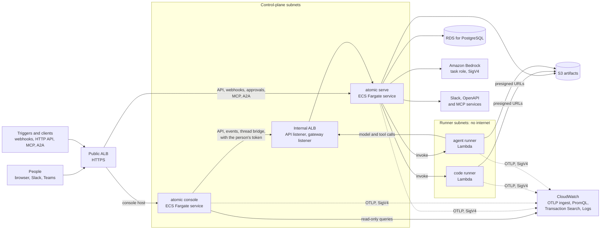
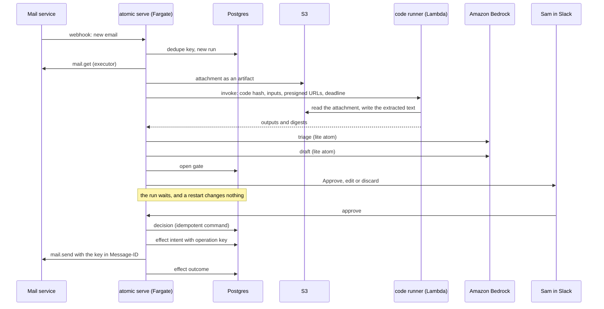
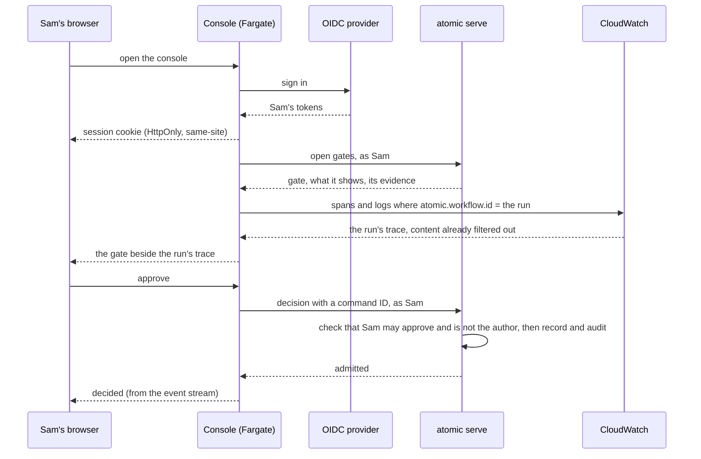

# atomic on AWS: control plane on Fargate, agents on Lambda

A design for running atomic's agents on AWS. The control plane, `atomic
serve`, and the atomic console run as ECS Fargate services; atoms that run
code run on AWS Lambda; every model call goes to Amazon Bedrock; workflows,
gates and the work graph live in RDS for PostgreSQL; every process exports
OpenTelemetry straight to CloudWatch, with no collector anywhere. Everything is
deployed from one YAML CloudFormation template.

> **Status.** Design only, and forward-looking; nothing here deploys yet. It
> assumes three things are delivered:
>
> - **atomic 1.0** as planned in `atomic-planning/atomic-scaffold-plan.md`.
> - **atomic's own telemetry export:** Codex's telemetry routed through
>   atomic's export pipeline, an export-time content filter on every signal,
>   and SigV4-signed export to CloudWatch, whether through a Codex fork or
>   upstream (`atomic-xt2b.5` to `.8`, `atomic-jalw.1`).
> - **The atomic console** (M49 and the stages of
>   `atomic-planning/atomic-web-console-plan.md`), deployable as its own
>   service and drawing its telemetry screens from CloudWatch.
>
> Its main output is [the gaps in atomic](#gaps-in-atomic) that the rest of
> the deployment still exposes.

## What it runs

Agents, not coding sessions: workflows such as the
[email assistant](https://github.com/atomic-agentic/atomic-demos/tree/main/email-assistant),
support escalation, incident response or document processing. Their shape:

- **Triggers** start runs: webhooks, schedules, Slack messages.
- **Steps** are mostly lite atoms (one typed model call), OpenAPI and MCP calls
  through atomic's executor, and Codex atoms that use declared tools.
- **Gates** wait, often for days, for a person to approve in Slack, Teams or
  the console.
- **Effects** reach the outside world only through the effect ledger, after a
  gate where one is needed.
- **Code runs only where an atom carries it:** `---ts` blocks and scripts
  (M17, M52), exec atoms that parse files, stdio MCP servers, or a Codex atom
  that needs a shell.

Model turns are seconds to a few minutes, and nothing runs while a gate
waits. The untrusted part is small and specific: code that runs on input from
outside.

## Where each part runs

**The control plane runs on ECS Fargate,** as atomic's plan designs it: a
long-lived `atomic serve` holding leases in Postgres, waking on `LISTEN/NOTIFY`,
firing its own timers, keeping Codex threads in memory, and serving the HTTP
API, webhooks, approval channels, MCP, A2A and remote attach. A first draft of
this design put the control plane on Lambda too; the
[appendix](#appendix-a-control-plane-on-lambda) keeps what that would take,
since most of it is work atomic would need anyway to scale to zero.

**The console runs beside it as its own Fargate service:** the browser's only
entry point, signing people in with OIDC and acting for them against
`atomic serve`. It reads runs, gates, transcripts and the work graph from
`atomic serve`, never from the database, and draws traces, metrics and logs
from CloudWatch.

**Atoms run where what they do requires:**

| Atom or step | Runs in | Why |
| --- | --- | --- |
| Lite atoms, OpenAPI and MCP calls through the executor, gates, workflow code | The control plane | No code executes. A Lambda would only wait on the model, and credentials stay where they already are |
| Codex atoms with declared tools and no shell | The control plane, with Codex's shell tool off | Codex's sandbox cannot start on Fargate, so the control plane never runs model-directed commands |
| Atom code: `---ts` blocks, scripts, exec atoms, file parsers | `code` runner on Lambda, one invocation per execution | Untrusted code on untrusted input gets a microVM, sees only its declared inputs, and returns its outputs |
| Codex atoms that need a shell, and stdio MCP servers | `agent` runner on Lambda, one invocation per attempt (harness mode) | The whole turn runs inside the microVM; its model and tool calls go back to the control plane, which holds the credentials |

Codex's sandbox cannot start on either platform; the [spikes](spikes/README.md)
ran Codex's own `bwrap` on both. Fargate refuses user namespaces. Lambda
refuses them too, has no Landlock, and its seccomp policy rejects even the
`prctl` bubblewrap starts with. On Lambda the execution environment is a
Firecracker microVM of its own, which is the boundary; Fargate offers no such
boundary to a command run inside the control plane's task.

## Shape

| Part | Runs as | Notes |
| --- | --- | --- |
| Control plane | ECS Fargate service, control-plane image by digest | One task until atomic's multi-worker fencing (M19) is in place, then two or more. Bedrock through the task role, so no model key exists anywhere; other secrets from Secrets Manager |
| Console | ECS Fargate service, console image by digest | Two or more tasks; it holds no state. Signs people in with OIDC (M27), forwards each person's token to `atomic serve`, relays server-sent events and the thread bridge, and queries CloudWatch for its telemetry screens. No database access and no approving credential of its own |
| Amazon Bedrock | Codex's Bedrock provider and atomic's lite atoms, signed with the task role | Models per tier as model or inference-profile IDs; the only model endpoint the deployment uses (see decision 8) |
| Public ALB | HTTPS with an ACM certificate | One host for the console; routes on another host for the HTTP API, webhooks, Slack and Teams interactivity, MCP and A2A streams, and WebSocket remote attach |
| Internal ALB | Two listeners with separate security groups | The **API listener**, reachable only from the console: the HTTP API, the event stream and the thread bridge. The **gateway listener**, reachable only from runner subnets: model calls, tool calls that need secrets, artifact grants, heartbeats and attempt completion, each with the attempt's token and epoch. A runner can never reach the API listener |
| `code` runner | Lambda, container image, in runner subnets | Deno and the toolchains atom code declares (M52). Synchronous invoke: inputs and outputs as artifacts, one execution per invocation |
| `agent` runner | Lambda, container image, in runner subnets | `atomic runner` in harness mode with Codex. Asynchronous invoke; completion reported to the gateway |
| RDS for PostgreSQL | Multi-AZ, KMS-encrypted, point-in-time recovery | durare, the gate store, the work graph, the effect ledger. Only the control plane connects |
| S3 | Versioned, KMS-encrypted | The artifact store (M35): files in and out of atom code, large results, Codex transcripts from runners |
| Telemetry | atomic's in-process exporter in every process, Codex's signals included | Content filtered before export, signed with SigV4 by the task or function role, sent straight to CloudWatch's OTLP endpoints. No sidecar, extension or collector service (decision 7) |
| CloudWatch | OpenTelemetry metrics (queried with PromQL), Transaction Search for spans, CloudWatch Logs, Application Signals | The backend for everything, and the source of the console's telemetry screens. Amazon Managed Grafana is optional, for operators who want the repository's dashboards |
| VPC | Three subnet tiers in two or three Availability Zones | Control plane and console (a Bedrock endpoint, NAT for Slack, APIs and the OIDC provider), runners (no route out; endpoints for S3, Lambda and CloudWatch only), database |

## How a run moves

The email assistant, with one extra step to show the Lambda path: an exec atom
that extracts text from an attachment.

An `agent` runner attempt is the same from the control plane's side, except
that the invoke is asynchronous: the runner calls the gateway listener for
every model and tool call during the turn, uploads its result through
presigned URLs, and reports completion; Lambda's on-failure destination and a
missed heartbeat tell the control plane about a crash.

### The same gate, approved in the console

The console never decides anything itself: `atomic serve` checks the
decision against Sam's identity, exactly as for a Slack approval, and the
console's own credentials cannot approve a gate.

## Decisions

1. **The control plane on Fargate, not Lambda.** atomic's control plane is a
   long-lived process by design, and Fargate runs it as designed. Remote
   attach, `LISTEN/NOTIFY`, in-process timers and in-memory Codex threads all
   work. The cost is a small always-on task, and the deployment has to respect
   that two tasks can briefly overlap during a rollout (decision 6).
2. **Atoms are placed by what they do, not all on Lambda.** A lite atom on
   Lambda would cost a cold start and a gateway round trip to make one model
   call that the control plane makes anyway. Lambda is for code: that is where
   a microVM per execution protects something.
3. **Credentials never enter a runner.** Runners reach only the gateway
   listener and S3, and S3 only through presigned URLs for the objects of their
   own execution. In the `agent` runner, Codex's provider base URL points at a
   loopback shim in `atomic runner` that forwards to the gateway. Each runner's
   role may do nothing but export its telemetry; its role credentials are in
   its environment like any Lambda's, so that is all model-directed code can do
   with them.
4. **No model-directed commands in the control plane.** Codex's sandbox
   cannot start on Fargate. Rather than run commands unsandboxed beside the
   database credentials, every atom that needs a shell or runs code is placed
   on a runner, and `atomic check` refuses a placement that would break this.
5. **RDS for PostgreSQL, connected directly.** A long-lived control plane
   holds a small pool, so RDS Proxy is optional (faster failover), not needed
   for connection storms. The password comes from Secrets Manager with
   rotation.
6. **One control-plane task until fencing lands.** ECS replaces tasks by
   starting the new one before stopping the old, which briefly runs two
   owners. Until M19's ownership epochs are in place, the service deploys
   with a minimum healthy percent of 0 and a maximum of 100: stop, then start,
   with durare recovering unfinished runs. That trades a short outage per
   deploy for correctness. The console has no such constraint and rolls
   normally.
7. **Every process exports straight to CloudWatch.** atomic's exporter signs
   with SigV4 using the task or function role and applies the content filter
   before anything leaves the process: the text of prompts, model replies and
   tool calls (email bodies, API responses, customer data) never reaches
   CloudWatch, where anyone with log or trace read access in the account could
   see it. Codex's signals, including `codex.tool_result` with its tool
   arguments and output, go through the same pipeline. CloudWatch then does
   what a collector used to: it stores OpenTelemetry metrics natively and
   queries them with PromQL, keeps every span through Transaction Search, and
   derives request rate, errors and latency in Application Signals. Runners
   flush before each invocation returns; in the spikes a warm export took
   20 to 60 ms per signal from a subnet with no route out. Traces need
   CloudWatch Transaction Search, which is off by default and account-wide:
   without it the traces endpoint answers 400, so the template turns it on
   (`AWS::XRay::TransactionSearchConfig`). Delta counters are stored natively,
   so runners can export deltas. Tail sampling is given up, since it
   needs one collector that sees whole traces; at agent volumes, a few spans
   per step, keeping every span costs little. A collector gateway can still be
   added for tail sampling or an independent content backstop, without
   changing atomic.
8. **Every model call goes to Amazon Bedrock, signed with the control plane's
   task role.** At atomic's pinned Codex revision, Codex's Bedrock provider
   falls back to the AWS SDK's default credential chain and signs with SigV4,
   so the task role is the whole of the model credential. It speaks to two
   OpenAI-compatible Bedrock endpoints: Mantle
   (`bedrock-mantle.<region>.api.aws/openai/v1`, in twelve commercial Regions
   and GovCloud) and Runtime (`bedrock-runtime`). Its defaults are OpenAI
   models hosted on Bedrock, which eases the plan's concern about how Codex
   atoms behave on other models. What follows:
   - **IAM can enforce the allowlist only on Runtime.** Runtime checks
     `bedrock:InvokeModel` against the model or inference profile (and a
     `project/default` resource), so a role allowed one model is refused
     another. Mantle checks `bedrock-mantle:CreateInference` against the
     project only, so a role that can call Mantle can call every model the
     account has. The deployment therefore uses the Runtime endpoint, keeps
     Codex's managed `models` requirement as a second check, and grants no
     `bedrock-mantle` permission. Both endpoints are reachable through
     PrivateLink, so the control plane needs no NAT for model calls.
   - **Model access is a prerequisite.** OpenAI's frontier models on Bedrock
     are granted per account ("not available for this account ... contact AWS
     Sales"), and the open-weight `gpt-oss` models do not support the
     Responses API on the `/openai/v1` route Codex's Bedrock provider builds.
     Codex atoms need the account to have access to the tier's OpenAI models
     before go-live,
     and that access is granted by AWS on request: accepting a model's
     Marketplace offer is necessary but not enough. Each model's tokens-per-
     minute quota must also be non-zero on the endpoint the deployment uses;
     the spikes found GPT-5.6 Luna at zero on Runtime and non-zero on Mantle.
     Lite atoms are not limited this way: Qwen 3 and Gemma 3 models, which need
     no special access, answer Runtime's chat completions with output that
     follows a strict JSON schema, so a workflow made only of lite atoms (the
     email assistant is one) can be tested with them now.
   - **gpt-oss-120b works today, on Mantle's other route.** Mantle's `/v1`
     route serves `openai.gpt-oss-120b` with the Responses API, function tools,
     tool results and streaming, everything a Codex atom needs, and Codex's
     `amazon-bedrock` provider can be pointed there by overriding `base_url`
     (see [the spikes](spikes/README.md#gpt-oss-120b-on-mantles-v1-route)).
     A real Codex turn there works for plain replies; tool turns need
     `web_search = "disabled"` and `[features] multi_agent = false`, and a
     rewrite of assistant messages, which the route rejects in the standard
     list-of-parts form (atomic's loopback shim is the natural place for it).
     AWS's supported path is GPT-5.6 Sol, Terra or Luna on Codex's built-in
     provider with no override, so this is a testing route only. Two costs: Mantle cannot be limited to one model by IAM, so
     Codex's managed `models` requirement is the only allowlist on that route,
     and strict JSON-schema output does not work there for gpt-oss, so lite
     atoms on it return their output through a strict `submit` tool.
   - **Runners never call Bedrock.** The `agent` runner's Codex uses the
     loopback shim, not its Bedrock provider. The runner's role has no
     Bedrock permission: Lambda puts the role's keys in the environment, and
     Codex's provider would otherwise pick them up.
   - **Residency is a choice of inference profile.** Global cross-Region
     inference profiles may serve a request outside the deployment's
     geography; a parameter selects geographic profiles or single-Region
     models instead (M30).
   - **Bedrock's own logging stays off.** Model invocation logging records
     prompts and responses, outside atomic's content controls. The template
     leaves it off, or sends it to a KMS-encrypted bucket that only auditors
     can read.
   - **Cost by project.** Application inference profiles, tagged per project
     or team, give Bedrock's bill the same breakdown as atomic's cost
     attribution (M34).
9. **The console is its own service, acting for people, never for itself.**
   It scales and deploys apart from the control plane, and keeps the public
   browser surface off `atomic serve`. The browser talks only to the console
   (one origin, an HttpOnly session cookie); the console talks to
   `atomic serve` on the internal API listener and forwards each person's
   OIDC access token, which `atomic serve` validates and authorizes as it
   would any client (M27). The console's own service identity can read but
   never decide, so a compromised console cannot approve a gate as anyone.
   It holds no database credential: everything comes through the API, as the
   console plan requires ("reads come from the run record").
10. **The console draws telemetry from CloudWatch, not a link out.** The
    console plan links out to the trace backend in the team profile. With
    CloudWatch as the only backend, the console can instead query it read-only
    with its task role: spans from Transaction Search and logs from
    CloudWatch Logs filtered by `atomic.workflow.id`, metrics with PromQL.
    atomic still stores nothing and runs no query engine; CloudWatch does.
    Since the content filter ran before export, these screens show timings,
    statuses and costs, not text. Transcripts come from the run record through
    `atomic serve`, under the person's own authorization.

## The CloudFormation template

One file, `template.yaml`, validated with `cfn-lint` and `cfn-guard` in CI.
CloudFormation does not build images, so a release is two steps: build and push
the control-plane, console and runner images to ECR, then deploy with their
digests as parameters (images are pinned by digest, as everywhere in this
repository).

| Section | Resources |
| --- | --- |
| Network | VPC, three subnet tiers, NAT gateways for the control-plane tier only, VPC endpoints (S3 gateway; Bedrock Runtime, Lambda, Secrets Manager, KMS, ECR, STS, and CloudWatch Logs, metrics and X-Ray for telemetry from runner subnets), security groups: the console reaches only the API listener and CloudWatch; runners reach only the gateway listener and the endpoints; only the control plane reaches RDS |
| Data | `AWS::RDS::DBInstance` (Multi-AZ, `ManageMasterUserPassword`), parameter and subnet groups, a KMS key; optional `AWS::RDS::DBProxy` |
| Storage | S3 bucket with versioning, lifecycle rules per prefix, and a policy limited to the control plane's role |
| Control plane | ECS cluster, task definition (image digest, CPU and memory, secrets, log configuration, health check), service (deployment percentages from decision 6), the internal ALB with its two listeners, target groups on atomic's readiness endpoint |
| Console | Task definition and service in the same cluster (image digest, OIDC client secret from Secrets Manager, a rolling deployment), a host rule on the public ALB, the ACM certificate |
| Runners | `AWS::Lambda::Function` (`PackageType: Image`) for `code` and `agent`, each with reserved concurrency as its share of `max_concurrent_atoms`, VPC configuration in runner subnets, and for `agent` an event invoke config with no retries and an on-failure destination |
| Observability | `AWS::XRay::TransactionSearchConfig` (with its indexing share; the per-run queries do not need indexing) and the CloudWatch Logs resource policy that lets X-Ray write `aws/spans`, log groups with retention, Application Signals, alarms; optionally an Amazon Managed Grafana workspace with a SigV4 Prometheus data source. No collector resources |
| Identity | One role per task and function, each least-privilege: the control plane may call `bedrock:InvokeModel` on the listed models and inference profiles and on `project/default`, and nothing in `bedrock-mantle`, invoke the runners, read its secrets, use the bucket, connect to RDS and export telemetry; the console may query CloudWatch read-only (Logs Insights and PromQL), read its OIDC secret and export telemetry; runners may only export telemetry |
| Models | Application inference profiles per tier, tagged for cost; Bedrock model invocation logging off, or to a restricted, KMS-encrypted bucket |
| Deploy-time | A one-off ECS task that runs `atomic migrate` (M36) before the control-plane service moves to the new image |

Parameters: the image digests, environment name, VPC CIDR, database instance
class and storage, control-plane CPU, memory and task count, console CPU,
memory and task count, runner memory, ephemeral storage and concurrency, the
Bedrock model or inference-profile ID for each tier, the inference-profile
geography, whether to keep Bedrock
invocation logs, the OIDC issuer, audience and console client, the console and
API host names, the ACM certificate, whether to create the Grafana workspace,
and retention for logs and telemetry.

## Gaps in atomic

What this deployment still needs from atomic, beyond what the status note
assumes is delivered. Each names the milestone or beads issue it is closest
to. **Blocking** means the deployment cannot work without it.

| # | Gap | Why this deployment exposes it | What atomic needs | Closest |
| --- | --- | --- | --- | --- |
| 1 | **Blocking.** Placement by what an atom does | The control plane has no sandbox, so atoms that run code or need a shell must go elsewhere, and nothing may silently fall back to running them in-process | Each backend states at connect whether it sandboxes commands, its maximum execution time and whether it keeps a workspace; atomic places each atom on a backend that satisfies it, and `atomic check` reports the placement and refuses an impossible one | M23 (`atomic-3bj`), M24 |
| 2 | **Blocking.** A request/response backend for atom code | The `ExecutionBackend` plans for sessions (exec-server, pods, actors); a Lambda invocation is one call with no inbound connection | A `code` execution contract: code hash, declared inputs as artifact references, declared environment and network, deadline in; outputs, digests, exit class and logs out. Fits M17's Deno process and M52's exec atoms, which atomic runs, not Codex | M17, M52, M24 |
| 3 | **Blocking.** Health and readiness | ECS and the ALBs need endpoints to decide when a task takes traffic and when to replace it | Liveness, readiness (database reachable, migrations current, recovery done) and graceful shutdown on SIGTERM within the stop timeout | `atomic-exnm` |
| 4 | **Blocking.** Stable executor identity on a platform that renames tasks | durare recovers only runs owned by its executor ID, and every ECS deployment starts a task with a new ID | Recovery by lease and epoch, with executor identity a telemetry label; until then, a fixed executor ID per service, safe only with one task (decision 6) | `atomic-ctd6.1`, M19 |
| 5 | Harness-mode runner contract without A2A | Harness mode is planned through kagent's A2A contract (M26), which assumes a listening server | A request/response attempt contract for `agent` runners: pinned definition hashes, inputs, epoch, deadline and token in; candidate, usage and transcript reference out; the exit classes of `atomic-xaay` as error types | M24 (`atomic-xaay`), M26 |
| 6 | The runner gateway and loopback shim | Runner model and tool calls must reach the control plane, which holds every credential | A gateway listener in `atomic serve`, separate from its API (model calls with M56's per-request check, tool calls through the executor, artifact grants, heartbeats, completion), and a loopback endpoint in `atomic runner` that Codex's provider base URL and tool configuration point at | M56, M15, M21 |
| 7 | Running Codex with its sandbox off, by policy | bubblewrap is not expected to start in Lambda | A mode selected by managed requirements, never by an atom, that disables Codex's sandbox because the backend reports an outer boundary; network declarations enforced by the backend instead | `atomic-hfve.1` |
| 8 | Attempt hygiene in reused environments | Lambda reuses an execution environment for later invocations, possibly of another run. In the spikes, files in `/tmp`, background processes and environment changes all survived into the next invocation, and `/tmp` survived even a crash of the runtime | The runner empties `/tmp`, kills every process the execution started and resets its environment before it returns, since exiting does not clean `/tmp`; it refuses work for a different tenant than the environment first served | M24, M29 |
| 9 | Scoped artifact grants | Runners never get bucket credentials, and files exceed invocation payloads (6 MB synchronous, 1 MB asynchronous) | Per-execution, single-object, short-lived upload and download URLs, with the digest verified before an output is accepted | M35, M52 |
| 10 | Codex transcripts from ephemeral places | Fargate's task storage and Lambda's `/tmp` both disappear, and Codex's state database is per host | Transcripts written to the artifact store at the end of each attempt; Codex's state database treated as a cache. This settles `atomic-oqff` for both | `atomic-oqff` |
| 11 | Secrets from AWS, rotating | Secrets Manager rotates the database password; ECS injects secrets as environment variables, which atom commands would inherit if any ran in-process | An AWS Secrets Manager backend for the pluggable secrets backend, reconnecting after rotation; and `atomic-xi0.1`, so injected secrets never reach atom code | `atomic-r6p0`, `atomic-xi0.1` |
| 12 | Telemetry from short-lived runners | Lambda freezes the environment after each invocation, and runners now export straight to CloudWatch | A forced, synchronous, bounded flush before returning (tens of milliseconds per signal, measured); `traceparent` carried in every invoke; delta temporality for runner counters, which CloudWatch stores natively | M44, `atomic-hfve.4` |
| 13 | Version-aware recovery across deploys | A deploy replaces the binary; durare recovers only runs of the same application version, which defaults to a hash of the binary | An explicit application version recorded on each run, and a rule for what a new release does with unfinished runs of the old one | M36 |
| 14 | Steering an atom in a runner | Steer, stop and take-over (M10, and the console's live controls) deliver input to a live turn, which in an `agent` runner has no inbound connection | The runner polls the gateway for journalled commands between model calls, or the backend states that it does not support steering and the console hides the controls | M9, M10, M49b |
| 15 | **Blocking.** Lite atoms on Bedrock | Most of an agent workflow's atoms are lite atoms, and atomic makes their model calls itself, not through Codex; the plan notes that lite atoms need their own verified authentication | A Bedrock path for lite atoms with SigV4 from the default credential chain and schema-constrained output. It must speak Runtime's chat completions with a JSON-schema `response_format` (Qwen and Gemma handle strict schemas there), and fall back to a strict `submit` tool with `tool_choice: auto` where schema enforcement is missing, as it is for gpt-oss on Mantle; the repair turn covers what either misses. Signing can reuse Codex's `codex-aws-auth` | M2, M34 |
| 16 | Bedrock quotas and throttling | Bedrock limits tokens and requests per minute for each model in each Region, per account, and answers with throttling errors | Atomic's shared rate limits seeded from the account's Bedrock quotas; a throttled request falls back to the next entry in the tier, such as another inference profile, before it fails | M34 |
| 17 | SigV4-signed OTLP export, with an in-process content filter | CloudWatch's OTLP endpoints take only SigV4 for traces, and no collector runs to filter content | **Assumed delivered** (see the status note) | M44 (`atomic-xt2b.5` to `.8`), `atomic-jalw.1` |
| 18 | **Blocking.** The console as a separate service | The console plan embeds the console in `atomic serve`: static assets, an in-process thread bridge, one origin | `atomic serve`'s API, event stream and thread bridge usable by a console in another process, on an internal listener; the person's OIDC token accepted on every call, so authorization and the audit record are the person's; the console's service identity limited to reads; the console plan's security rules (no state change without a human session, `Origin` and `Host` checks, untrusted text escaped) kept across the hop | M49 (`atomic-mvy3`), console plan (`atomic-lone`, `atomic-ro1a`), M27 |
| 19 | The console's telemetry screens from CloudWatch | The console plan links out to the trace backend in the team profile; here CloudWatch is the only backend and the console draws from it | A read-only CloudWatch adapter for the trace, metric and log screens: spans and logs through Logs Insights by `atomic.workflow.id` and trace ID (about a second per run in the spikes, with no span indexing), metrics with PromQL (about 100 ms), keeping CloudWatch's dotted attribute names and `@resource.` prefixes; no storage, no query engine. It changes the console plan's team-profile position, so it needs a decision there first | Console plan (Telemetry: local viewer, team link-out), M44, M49 |

Gaps 1 to 4 are the ones to design before 1.0 freezes: they change the
`ExecutionBackend` statement at connect, add a second kind of backend, and fix
how recovery decides ownership. Gap 15 is blocking in practice but not a
design question: Codex already signs Bedrock requests, and lite atoms need the
same path. Gap 18 decides whether the console's security model survives being
moved out of `atomic serve`, so it belongs in the console plan's open
questions now.

## Gaps in this repository

- **Runner images.** The `code` and `agent` runners are new project images in
  [`../docker`](../docker), with `atomic runner` speaking Lambda's runtime API as
  the entry point, under Lambda's 10 GB image limit. [`../docker/python`](../docker/python)
  fills uv's cache in `/tmp/uv-cache`, which Lambda hides behind an empty
  `/tmp`; a Lambda variant builds the cache elsewhere and copies it to `/tmp` on
  start.
- **The content rules in one place.** atomic's export-time filter and
  [`../observability/otel-collector`](../observability/otel-collector)'s
  backstop must drop the same attributes. `atomic-xt2b.7` keeps the rule list
  in one file; the collector configuration here should be generated from it or
  checked against it.
- **Dashboards against CloudWatch, if Grafana is kept.** CloudWatch's PromQL
  keeps attribute names as they are (`atomic.workflow.id`, not
  `atomic_workflow_id`), prefixes resource attributes with `@resource.`, and
  needs a metric name in every selector, so the metric panels need their
  queries rewritten, not just a new data source. The trace and log panels
  assume Tempo and Loki and need X-Ray and CloudWatch Logs variants. The
  console covers run-level views either way.

## Spikes

Five of the spikes ran against a real account on 2026-11-17, in a VPC of their
own that was deleted afterwards; [`spikes/`](spikes/README.md) has the stack,
the probes and the full results.

| Spike | Result | What changed here |
| --- | --- | --- |
| Codex's sandbox on Lambda and Fargate | Cannot start on either. Fargate does have Landlock (ABI 2), and a process confined its own writes with it, with no namespaces | Confirms decision 4. Landlock is an option for atom code atomic runs itself, not for Codex's shell |
| Environment reuse on Lambda | `/tmp`, background processes and environment changes survive warm invocations; `/tmp` survives a runtime crash | Gap 8: the runner cleans `/tmp` itself; exiting is not enough |
| Bedrock from a private subnet | Mantle and Runtime both work through PrivateLink. Runtime can be limited to one model by IAM; Mantle cannot. OpenAI frontier models need per-account access. `gpt-oss-120b` serves the Responses API with tools and streaming on Mantle's `/v1` route; Qwen and Gemma answer chat completions with strict JSON schemas on Runtime | Decision 8: Runtime for an IAM-enforced allowlist, Mantle `/v1` with gpt-oss-120b for testing Codex atoms now; gap 15: lite atoms speak chat completions, or a `submit` tool |
| CloudWatch from runner subnets | OTLP logs, metrics and traces all accepted through VPC endpoints, 20 to 60 ms per warm request; traces only with Transaction Search on | Decision 7: the template enables Transaction Search |
| The console's queries | A run's spans and logs by `atomic.workflow.id` in about a second through Logs Insights, with no span indexing; metrics by PromQL in about 100 ms | Gap 19 is feasible as designed |

Still to run, since they need atomic itself or OpenAI model access on Bedrock:

1. **Cold starts.** Start time of the `code` runner with Deno and a typical
   toolchain, and of the `agent` runner with Codex.
2. **The gateway under a Codex turn.** Streamed model responses relayed
   through the gateway listener and the loopback shim, with the per-request
   policy check in the path.
3. **Rollouts.** Recovery time with stop-then-start deploys, and how long gate
   notifications and webhooks wait during one.
4. **Agent quality on Bedrock models.** The eval suites (M12) for the
   deployment's atoms, run against the tier's Bedrock models before go-live,
   for lite atoms and Codex atoms alike, once the account has access to them.

## Appendix: a control plane on Lambda

The first draft of this design ran the control plane on Lambda as well: an
`orchestrator` function per wake-up, SQS FIFO wake-ups with one message group
per run, EventBridge Scheduler for timers, RDS Proxy with IAM tokens. It is not
the plan, but what it would need from atomic is worth recording, because the
same seams let a control plane scale to zero anywhere:

- **Run to the next suspension point, then return,** instead of a loop that
  blocks in `recv`, sleeps and queue waits; durare exposing suspension rather
  than blocking.
- **Recovery by lease, not executor identity** (gap 4 above, needed on Fargate
  too).
- **Pluggable wake-ups and timers:** `LISTEN/NOTIFY` and in-process timers
  locally, SQS and EventBridge Scheduler there.
- **No listening sockets:** remote attach, exec-server and WebSocket
  app-servers have no home, so every surface becomes request/response.
- **Postgres through RDS Proxy with per-connection IAM tokens,** and durare's
  and sqlx's session state measured against proxy pinning.

Lambda durable functions are the other route to the same end, as a second
`DurableRuntime` adapter, at the cost of checkpoints outside Postgres (which
breaks transaction-step publication), payload limits of 1 MB per operation and
100 MB per execution, and a Rust SDK that is still an experimental preview.

## Sources

Codex's Bedrock support was read from `codex-rs/model-provider/src/amazon_bedrock/`
and its OTLP exporter configuration from `codex-rs/otel/src/config.rs`, at
atomic's pinned Codex revision (`rust-v0.169.0`). The console's design is from
`atomic-planning/atomic-web-console-plan.md`. AWS facts above were checked on
2026-11-17 against:

- [Lambda quotas](https://docs.aws.amazon.com/lambda/latest/dg/gettingstarted-limits.html)
- [Lambda isolation technologies](https://docs.aws.amazon.com/whitepapers/latest/security-overview-aws-lambda/lambda-isolation-technologies.html)
- [Fargate security considerations](https://docs.aws.amazon.com/AmazonECS/latest/developerguide/fargate-security-considerations.html)
- [Lambda Managed Instances: security and permissions](https://docs.aws.amazon.com/lambda/latest/dg/lambda-managed-instances-security.html)
- [Lambda durable functions: basic concepts](https://docs.aws.amazon.com/lambda/latest/dg/durable-basic-concepts.html) and [the durable execution SDK](https://docs.aws.amazon.com/lambda/latest/dg/durable-execution-sdk.html)
- [Avoiding pinning an RDS Proxy](https://docs.aws.amazon.com/AmazonRDS/latest/AuroraUserGuide/rds-proxy-pinning.html)
- [CloudWatch OTLP endpoints](https://docs.aws.amazon.com/AmazonCloudWatch/latest/monitoring/CloudWatch-OTLPEndpoint.html)
- [CloudWatch OpenTelemetry metrics with PromQL](https://aws.amazon.com/about-aws/whats-new/2026/06/amazon-cloudwatch-otel-metrics/) and [PromQL in CloudWatch and Managed Grafana](https://aws.amazon.com/blogs/mt/introducing-opentelemetry-promql-support-in-amazon-cloudwatch/)
- [CloudWatch Transaction Search](https://docs.aws.amazon.com/AmazonCloudWatch/latest/monitoring/CloudWatch-Transaction-Search.html)
