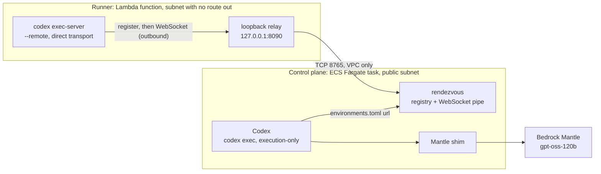

# Spike 11: execution-only placement on Lambda

Can atomic keep Codex's agent loop, its threads and every credential in the
control plane, and run only the commands in a Lambda function, although a
function accepts no inbound connections? The [Agent Substrate
spikes](../../../agent-substrate/spikes/results.md) ran this placement through
Substrate's router into an actor; here the connection has to start from the
function.

Run on 2026-11-18 in `us-west-2`, with Codex `rust-v0.169.0` from atomic's
fork at `f8e52f3` (the parent-death signal best effort, so commands start in
Lambda), built for Amazon Linux 2023.

## How it is wired

- **Codex's exec-server dials out.** `codex exec-server --remote URL
  --environment-id ID --remote-transport direct --aws-sigv4` registers with
  `POST {URL}/cloud/environment/{ID}/direct/register` (body
  `{"transport": "direct_jsonrpc_v1"}`, signed with the function's role), reads
  `{environment_id, transport, registration_id, url}`, then opens a WebSocket
  to `url` and serves plain JSON-RPC over it, one message per frame. This is
  Codex's own remote mode, built for AWS-hosted registries
  (`codex-rs/exec-server/README.md` at the pinned revision).
- **A loopback relay, because exec-server requires TLS otherwise.** The
  registry and the WebSocket must be `https`/`wss` unless they are on loopback,
  so exec-server talks to `127.0.0.1:8090` in the function, and the
  [handler](handler.py) relays the bytes to the control plane inside the VPC.
  With TLS on the control plane's listener, the relay goes away.
- **The [rendezvous](rendezvous.py)** stands in for what `atomic serve` would
  host: it answers the registration with a WebSocket URL, accepts
  exec-server's connection, and pipes it to the connection Codex opens from its
  `environments.toml` (`url = "ws://127.0.0.1:8765/harness/spike"`), timing
  each request.
- **The control plane** ([`control-plane.sh`](control-plane.sh)) runs the
  rendezvous, the Mantle [shim](../agent-runner/shim.py) and `codex exec` with
  `include_local = false`, `default_permissions = ":danger-full-access"` and
  `unified_exec_tty = false`. The task's role may call only
  `bedrock-mantle:CreateInference`.
- **The function's role may only write its logs,** and its security group
  allows out only TCP 8765 to the VPC. It holds no model credential and has no
  route to anything but the control plane.
- **The task** is the Agent Substrate spikes' `codex-atom`: `add` returns
  `a - b` and a test catches it, created in the function where the commands
  run.

## Results

| Run | Runner total | exec-server connected after | Codex turn | Commands, in the function | Result in the function |
| --- | --- | --- | --- | --- | --- |
| First invocation after the function was created | 34.6 s | about 30 s | 8 s | `ls -R`, `sed` ×2, `python3 test_calc.py` | `a - b` → `a + b`, test prints `ok` |
| Cold, a new environment after an update | 10.0 s | 1.7 s | 7 s | the same four | the same |
| Warm, the same environment | 6.2 s | 0.5 s | 5 s | the same four | the same |

Round trips through the rendezvous, function to control plane, per JSON-RPC
request (first run; the later runs were alike):

| Request | Count | Median | Max |
| --- | --- | --- | --- |
| `initialize` | 1 | 186 ms | 186 ms |
| `fs/getMetadata` | 12 | 2.4 ms | 48.6 ms |
| `process/start` | 4 | 12.8 ms | 106.2 ms |
| `process/terminate` | 4 | 1.4 ms | 1.4 ms |
| `fs/readFile` | 2 | 1.6 ms | 1.6 ms |
| `fs/writeFile` (the fix itself) | 1 | 2.0 ms | 2.0 ms |

The turn used 41 234 input and 615 output tokens on gpt-oss-120b. The Agent
Substrate spike's execution-only run took 8 s on a local model.

**What it shows:**

- **Execution-only placement works on Lambda,** with nothing listening in the
  function. Codex's file operations and process starts cost milliseconds over
  this path; the model dominates the turn.
- **The function needs no secret at all.** Model calls leave from the control
  plane, and the runner's only credential is the role that signs its
  registration, which a control plane can check or ignore.
- **A warm environment keeps what an earlier invocation started.** The first
  warm run failed at once with `Address already in use`: the previous
  invocation's relay thread was still listening. Anything the runner starts in
  the background has to be created once per environment, and anything per
  attempt has to end with the invocation (spike 2 found the same for files and
  processes).
- **The first invocation after creation was slow** (about 30 s before
  exec-server registered); later cold starts were not. Lambda had probably not
  finished optimizing the new image.
- **The function runs for the whole step.** Lambda bills it while Codex waits
  on the model, and one step must fit in 15 minutes.

## Files

| File | What it is |
| --- | --- |
| [`template.yaml`](template.yaml) | The VPC, the control-plane task definition, the runner function and their roles |
| [`handler.py`](handler.py) | The runner: the task, the loopback relay and `codex exec-server` |
| [`rendezvous.py`](rendezvous.py) | The registry and WebSocket pipe |
| [`control-plane.sh`](control-plane.sh), [`shim_main.py`](shim_main.py) | The control plane's entry point |
| [`Dockerfile.runner`](Dockerfile.runner), [`Dockerfile.control-plane`](Dockerfile.control-plane) | Both images; each needs the fork's `codex` in its build context, and the control plane also `../agent-runner/shim.py` |
| [`run.sh`](run.sh) | Starts the control plane, invokes the runner with its address, collects both sides |
